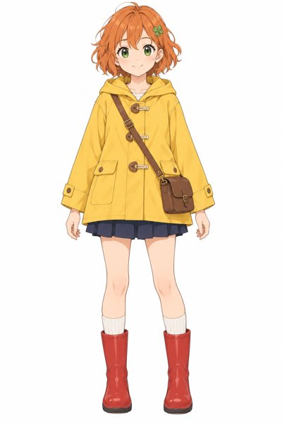
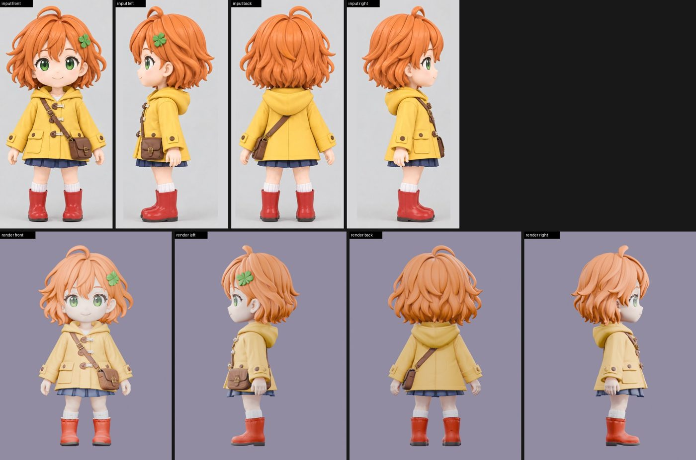

# image-to-figure-skill

An agent skill (`skills/image-to-figure/SKILL.md`) plus a command-line tool (`img2fig`) that turns one character image into a 3D collectible figure in the soft-vinyl art-toy style:

1. **Look-dev**: an image model renders the character as a chibi figure (front and 3/4 view).
2. **Turnaround**: a four-view sheet (front, left, back, right) on a flat background, same scale and ground line.
3. **Crop**: the sheet is split into four equal-size views by runs of background-coloured columns.
4. **Edit** (when needed): targeted fixes on the sheet ("remove the tail on the back view") while everything else stays the same.
5. **Model**: multiview image-to-3D on fal.ai. Tripo is the default; Hunyuan3D, Rodin and Meshy are available for a bake-off.
6. **Prep** in Blender: automatic orientation check against the front view, normalised height, decimation, a soft-vinyl material grade, optional cheek blush. Produces a `.blend` master and a clean GLB.
7. **Review**: renders from the same four angles as the turnaround plus a 3/4 and a face close-up, and a comparison sheet (input views above, renders below).
8. **Turntable**: a 360-degree video on a clear acrylic display base.

It is built for a coding agent (Claude Code, Codex, Cursor, OpenCode and similar) to drive, with you approving the spending and judging the look. Every command prints one JSON object, uses fixed exit codes, and passes provider and Blender errors through unchanged. Commands that cost money print a plan with a cost estimate and do nothing until you add `--execute`; a per-project budget refuses calls that would exceed it.

## Example

An original character generated for this example (left), and the comparison sheet `img2fig prep` writes for it: the cropped turnaround views on top, renders of the finished model from the same four angles below. Total spend for this run was $0.82.

<p>
  
  
</p>

## Requirements

- Python 3.10+ and [uv](https://github.com/astral-sh/uv)
- [Blender](https://www.blender.org/) 4.2 or newer, as a command-line binary (`blender` on PATH, or set `IMG2FIG_BLENDER`)
- ffmpeg, for the turntable video
- An OpenAI API key (image stages) and a fal.ai key (3D stage), read from the environment variables `OPENAI_API_KEY` and `FAL_KEY`

## Install

```bash
git clone https://github.com/grapeot/image-to-figure-skill
cd image-to-figure-skill
uv venv
source .venv/bin/activate
uv pip install -e '.[providers,dev]'
python -m pytest -q
img2fig doctor
```

### Installing the skill into your agent

Give your coding agent this repository's URL and ask it to install the skill. The agent should start from your workspace's `AGENTS.md` or `CLAUDE.md`, follow any routing file it points to, and add `skills/image-to-figure/SKILL.md` to the workspace's skill discovery: an entry in `rules/skills/INDEX.md` or `skills/INDEX.md` if one exists, otherwise a short pointer in `AGENTS.md` or `CLAUDE.md`.

## Quick start

```bash
export OPENAI_API_KEY=... FAL_KEY=...
export IMG2FIG_WORKDIR=./my_figure IMG2FIG_BUDGET_USD=5

img2fig estimate                                   # what a full run costs, no network
img2fig lookdev --ref character.png --description "clover clip on her LEFT side (viewer's right)"
img2fig lookdev --ref character.png --description "..." --execute
img2fig turnaround --ref character.png --description "..." --execute
img2fig crop
img2fig model --execute                            # Tripo; --provider all for a bake-off
img2fig prep                                       # writes renders/compare.jpg
img2fig turntable                                  # turntable/turntable.mp4
```

Check `views/` before paying for the 3D stage: whatever the image model put in the turnaround, including details it invented, ends up in the model. Fix those with `img2fig edit --fix "..." --execute` and crop again.

## Costs

Estimates as of 2026-10-31, with the default settings. Providers bill the real amount.

| Stage | Typical cost |
|---|---|
| Look-dev image (2048x1152, high) | about $0.06 (estimate shown: $0.13) |
| Turnaround sheet (3840x2160, high) | about $0.13 (estimate shown: $0.22) |
| One edit of the sheet | about $0.13 (estimate shown: $0.22) |
| Tripo model (HD texture, detailed geometry) | $0.60 |
| Bake-off of all four providers | about $4.00 |
| Blender stages and turntable | free (local) |

A full run with one edit costs about $1; the measured example run (character image, look-dev, turnaround, Tripo) cost $0.82. Image costs depend on tokens; the tool reports the figure implied by the returned token usage after each call and keeps a ledger in `spend.json`.

## Documentation

- `skills/image-to-figure/SKILL.md`: what an agent needs to run the pipeline, acceptance criteria, known pitfalls
- `docs/design.md`: architecture, command contract, exit codes, cost model
- `docs/test.md`: what the test suites cover

## License

MIT
